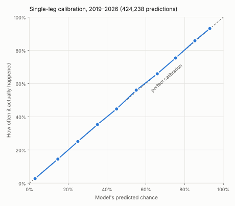

# NFL parlay model

[](https://github.com/akilatrades/nfl-parlay-model/actions/workflows/tests.yml)

A same-game parlay pricing model, built and tested in phases. The goal is a fair price for any combination of NFL player and game legs, to compare against prediction-market and sportsbook quotes. It grows out of my [same-game parlay correlation study](https://github.com/akilatrades/nfl-sgp-correlation).

| Phase | What it adds | Status |
|---|---|---|
| **1** | **A full range of outcomes for every player leg (yards, receptions, touchdowns), adjusted for the injury report, plus a live log of Kalshi prices to check them against** | **Done (this release)** |
| 2 | Links between legs (correlation), including extreme lines | Next |
| 3 | Pricing engine for any combo, a phone calculator, paper trading | Planned |
| 4 | Historical prop prices to test against real markets | If paper trading justifies it |
| 5 | Drive-level game simulator | Stretch |

## Phase 1 result

**Across 125,803 player-stat predictions from 2019 through week 5 of 2026, each made using only earlier games, the model's probabilities were calibrated to within about one percentage point in every band, and it beat each player's own recent average on all six stats.** The gain is large for quarterbacks and touchdowns and small for receiving and rushing yards, where a player's recent production is already a strong guide.



| Stat | Player-games | Typical miss: model vs recent average | Brier score improvement | Log loss improvement |
|---|---:|---:|---:|---:|
| Passing yards (starting QB) | 3,713 | **58.7 vs 65.2 yards** | 4.5% | 4.4% |
| Passing TDs (starting QB) | 3,713 | 0.90 vs 0.93 TDs | **5.8%** | **6.0%** |
| Anytime TD (WR, TE, RB) | 35,774 | 0.34 vs 0.34 TDs | 3.7% | 4.1% |
| Receiving yards (WR, TE, RB) | 35,774 | 17.0 vs 17.1 yards | 1.2% | 2.1% |
| Rushing yards (RB) | 11,055 | 19.1 vs 19.1 yards | 0.9% | 1.4% |
| Receptions (WR, TE, RB) | 35,774 | 1.31 vs 1.31 | 0.7% | 1.0% |

"Typical miss" is mean absolute error of the expected value. Brier score and log loss score the over/under probabilities at the lines below; lower is better, and the improvement is relative to the baseline. The baseline is each player's own recent average (same recency weighting) with the same outcome-spread layer, so the comparison isolates what the extra pre-game information adds. [Full summary](outputs/backtest/summary.csv)

### Calibration by line

| Leg | Happened | Model said |
|---|---:|---:|
| Receiving yards over 39.5 | 23.9% | 24.0% |
| Receiving yards over 79.5 | 7.1% | 7.0% |
| Receptions over 3.5 | 24.6% | 24.7% |
| Rushing yards over 49.5 | 25.7% | 25.6% |
| Passing yards over 249.5 | 40.8% | 41.3% |
| Passing yards over 299.5 | 19.7% | 20.7% |
| QB 2+ passing TDs | 45.2% | 44.5% |
| Anytime TD | 19.7% | 19.9% |

[All lines](outputs/backtest/by_line.csv) · [Calibration bands](outputs/backtest/calibration.csv) · [Bias by season](outputs/backtest/season_bias.csv)

For yardage, actual results fell at or below the model's 90th percentile 90% of the time (89.7% for passing yards, 90.0–90.2% for the others). For passing yards, a continuous stat, 10.8% fell at or below the 10th percentile and 50.2% at or below the median.

## How it works

1. **Data.** Weekly box scores for every QB, RB, WR and TE since 2012, weekly injury reports, and every game's closing spread, total and moneyline, from nflverse ([`fetch_data.py`](fetch_data.py)).
2. **Pre-game features, from earlier games only** ([`features.py`](parlay_model/features.py)):
   - *Usage:* the player's recent share of his team's targets, carries or pass attempts, and the team's recent volume. Recent games count most (exponential weighting, half-life of four games).
   - *Efficiency:* yards per target, carry or attempt, catch rate and touchdown rates over his last 24 games, shrunk toward the position average from earlier seasons, so a few lucky games do not dominate.
   - *Game environment:* the team's implied points (closing total and spread) and no-vig win probability, and what the opponent's defense has allowed recently.
   - *Teammates out:* the share of last game's targets and carries that belonged to teammates now listed Out or Doubtful on the injury report, split into the player's own position group and others.
3. **Expected value** ([`marginals.py`](parlay_model/marginals.py)). A Poisson regression per stat. Seasons are weighted so that one three years older counts half as much. [Fitted coefficients](outputs/projections/coefficients.csv): for example, anytime-TD expectations scale almost one-for-one with the team's implied points (coefficient 1.01 on the log scale).
4. **Range of outcomes.** For yards and receptions, the distribution of actual ÷ expected from the latest four seasons, kept separately for ten bands of expected value. This keeps the real shape, including zero-catch games and long tails. Anytime TDs follow a Poisson. Passing TDs vary less than a Poisson allows, so they use a binomial whose number of "chances" is fitted by likelihood.
5. **Backtest** ([`evaluate.py`](parlay_model/evaluate.py)). The model is refit before every four-week block (weeks 1–4, 5–8, 9–12, 13–18) on all earlier games, from 2019 through 2026 week 5, and scored on the block it has not seen.

## The injury report

When a starter is ruled out, his targets and carries go somewhere. Phase 1 reads the final injury report, drops players listed Out or Doubtful, and gives the model the share of last game's volume they leave behind. The fitted coefficients say where it goes: teammates at the missing player's position absorb about all of his targets (coefficient 1.15 for receiving yards, where 1.0 means "in proportion to their usage"), while players at other positions pick up much less (0.32). [Coefficients](outputs/projections/coefficients.csv)

On player-games where teammates ruled out had at least 20% of the team's targets (carries, for rushing), the backtest with the injury report against the same backtest without it:

| Stat | Player-games | Actual average | Expected, without injuries | Expected, with injuries | Brier improvement |
|---|---:|---:|---:|---:|---:|
| Receiving yards | 1,378 | 25.5 | 21.4 | **25.6** | 1.6% |
| Receptions | 1,378 | 2.32 | 1.98 | **2.30** | 1.7% |
| Rushing yards | 500 | 30.8 | 23.1 | **31.5** | 1.6% |

Without the report the model under-projected the remaining players by 15–25% in those games; with it the average projection lands within about 2% of what happened. Mean absolute error rose slightly (receiving 17.2 → 17.7 yards), because the extra volume is spread across every teammate when in practice one or two absorb it. Overall, on all games, the change is small because most weeks have no major absence. [Injury effect](outputs/backtest/injury_effect.csv)

## Checking against Kalshi

Phase 1's probabilities still have to beat a market. Kalshi publishes its NFL player-prop prices (passing, rushing and receiving yards, receptions, passing TDs, anytime TD) as ladders of contracts such as "80+ receiving yards", priced in cents, and the data needs no login.

- [`log_kalshi.py`](log_kalshi.py) saves every open market. A [scheduled workflow](.github/workflows/kalshi.yml) runs it daily and shortly before each kickoff window, writing to `data/kalshi/`.
- A [daily workflow](.github/workflows/refresh.yml) refreshes nflverse data and the injury report, reruns projections, and saves the model's over-probability at every ladder line (`outputs/projections/ladders/`), time-stamped.
- [`compare_market.py`](compare_market.py) matches each Kalshi market to the model's price made before kickoff and the last Kalshi price before kickoff, adds the result once the game is played, and scores both. It also records the paper trades a simple rule would make: buy whichever side the model prices at least 5¢ above the ask after Kalshi's fee (0.07 × price × (1 − price) per contract, before rounding). Results go to [`outputs/market/`](outputs/market/).

The log started in October 2026 (week 6), so there are no settled comparisons yet. The question it answers is the one that matters: are the model's prices better than Kalshi's, and on which kinds of props?

## This week's projections

[`outputs/projections/2026_week06.csv`](outputs/projections/2026_week06.csv) lists every player expected to play in 2026 week 6: the expected value and the 10th, 25th, 50th, 75th and 90th percentiles for yardage and receptions, and the chance of 1+, 2+ and 3+ touchdowns. Read the percentiles as "a 10% chance of fewer than p10, a 10% chance of more than p90".

Projections refresh daily. Players listed Out or Doubtful are removed and their volume is handed to teammates; Questionable players stay in, flagged in the `injury_status` column. The injury report is final on Friday (earlier for Thursday games), so earlier runs in the week are provisional. Late scratches are not covered: check the news before kickoff. The starting quarterback is the one listed in the schedule.

## Run it

```bash
pip install -r requirements.txt
pytest
python run_backtest.py      # walk-forward backtest, 2019 to the latest week (~1 minute)
python run_projections.py   # projections and a probability ladder for the next week
python fetch_data.py        # optional: refresh the data from nflverse
python log_kalshi.py        # snapshot Kalshi prices (needs internet access to Kalshi)
python compare_market.py    # score model vs Kalshi on settled games
```

Tests check that features use only earlier games, the shrinkage and EWMA arithmetic by hand, relocated team codes, the upcoming-week roster, vacated usage from the injury report, that probabilities are calibrated and monotonic on simulated data, that the model beats the baseline on the real 2025 season, Kalshi parsing and fees, and that the market comparison only uses prices from before kickoff.

## What I learned / what I would do differently

The structure helps most where a player's own history is a weak guide. A quarterback's yards and touchdowns depend heavily on the game script the market expects, so implied points and win probability add a lot. A receiver's recent yards already contain most of what usage and efficiency can say, so the gain there is small. I also tried a league-wide passing-environment feature to track seasons like 2023, when passing dropped; it made calibration worse, so I removed it. The injury report fixed a clear bias for teammates of an injured starter, but adding it to the quarterback and touchdown models did not improve their scores, so it is left out there. Next I would hand vacated targets to the specific player who inherits the role, add snap counts, model quarterback rushing, and, in Phase 2, link the legs.

## Limitations

- **No market test yet.** These are the model's own probabilities. The Kalshi log has no settled games yet, and there are no historical prop prices before it (Phase 4), so there is no evidence yet that the model beats any market.
- **Injuries are handled simply.** Missing volume is spread in proportion to teammates' usage; late scratches after the final report and in-game injuries are not covered.
- **League-wide shifts.** Averaged over a season, passing-yard probabilities ran up to about 4 points high (2021) and 5 points low (2023, when league passing dropped). Passing TDs stayed within 2.5 points by season and the other stats within about 1.2 points.
- **Not yet modeled:** QB rushing, kickers and defense. Fullbacks are grouped with running backs.
- Regular season only. Players need three earlier games to be projected.

## Data

[nflverse](https://github.com/nflverse) schedules, player statistics and injury reports; [Kalshi](https://docs.kalshi.com/getting_started/quick_start_market_data) public market data. The trimmed nflverse files in `data/` include a retrieval date, source URLs and SHA-256 hashes.
